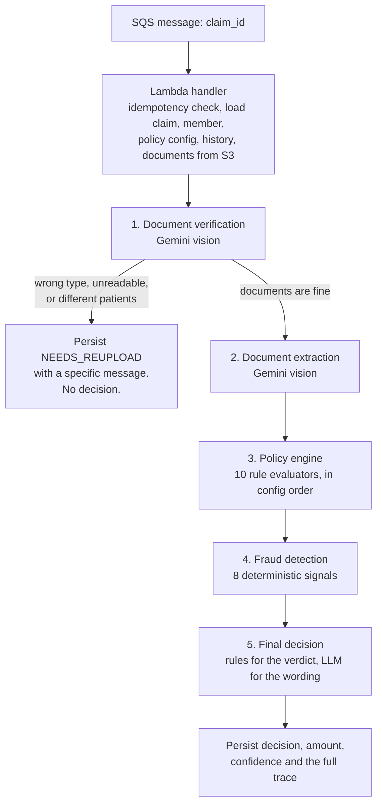
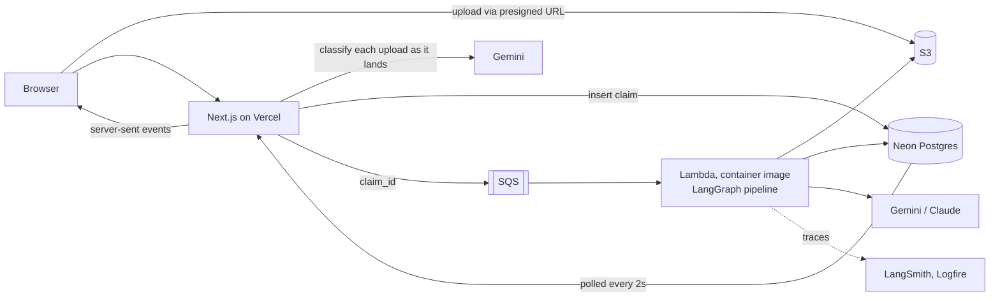

# MedClaim AI

Decides health insurance claims from photos of the paperwork. A member uploads a bill and a prescription; five agents check the documents, read them, apply the policy, look for fraud and reach a verdict, and every step is written down so the decision can be explained to the member and audited by operations.

**Try it:** https://medclaim-ai-six.vercel.app/demo (no account needed)

## A 60-second tour

1. Open the [sample claims](https://medclaim-ai-six.vercel.app/demo). Pick "Clean consultation" and press **Run the claim**. You are watching a replay of a real run: the documents, what each agent extracted, each of the ten policy rules, the fraud score and the final message are exactly what the pipeline wrote to the database.
2. Pick "Wrong documents". The pipeline stops after the first agent, tells the member which document is missing, and makes no decision.
3. Pick "Dental, part cosmetic" for a partial approval decided line by line, and "Four claims in a day" for a claim that passes every policy rule and is still sent to a person.
4. To run claims through the live system, create an account and open the [test runner](https://medclaim-ai-six.vercel.app/admin/eval). It submits any of the twelve test cases to SQS, shows the claim moving through the agents, and compares the result with what the case expects. One claim takes about a minute.
5. The [operations dashboard](https://medclaim-ai-six.vercel.app/admin) lists every claim the system has decided, with its full trace.

Submitting your own claim works too (`/claims/new`), but the policy rejects any bill dated more than 30 days ago, so old sample documents will be turned down by the submission-deadline rule. That is the system working, not a bug.

## How a claim is decided



The graph is a LangGraph `StateGraph` over one typed state object (`worker/core/state.py`). Each agent reads what earlier agents wrote and adds its own key:

| # | Agent | Reads | Writes | How it works |
|---|-------|-------|--------|--------------|
| 1 | Document verification | document images, category, policy | `doc_verification` | A vision model names each document's type, scores its quality and reads the patient name. Code then checks the set against the category's required types and compares patient names. Any failure sets `should_stop_early` with a reason and a message written for the member. |
| 2 | Document extraction | document images | `extracted_data` | A vision model returns structured prescription and bill data (diagnosis, medicines, line items, totals) with a confidence per field. |
| 3 | Policy engine | `extracted_data`, member, policy, claim history | `policy_evaluation` | An orchestrator runs the rules listed under `evaluation_rules` in the policy config, in order. Eight are plain code. Two (condition waiting period, exclusion check) ask an LLM to classify the diagnosis against the policy's lists. A blocking rule that fails ends the evaluation. The last rule computes the amount: network discount first, then co-pay. |
| 4 | Fraud detection | claim history, `extracted_data`, `doc_verification` | `fraud_evaluation` | No LLM. Eight signals (same-day claims, monthly claims, high value, several providers in a day, altered documents, amount mismatch, date mismatch, duplicate claim), each with a severity and a weight, summed into a score from 0 to 1. Thresholds come from the policy config. |
| 5 | Final decision | everything above | `final_decision` | The verdict is rule-based: a fraud flag forces `MANUAL_REVIEW`, a policy failure gives `REJECTED`, otherwise `PARTIAL` or `APPROVED`. Confidence starts at 0.95 and each deduction is itemised (degraded steps, weak extraction, poor document quality, raised fraud score). An approval with confidence under 0.60 becomes a manual review. An LLM then writes one message for the member and one for operations, with fixed templates as the fallback. |

### What happens when something breaks

- **Verification is critical.** If it throws, the node re-raises and the handler marks the claim `FAILED`.
- **The other four agents are degradable.** Each node is wrapped (`PipelineNode` in `worker/core/pipeline.py`): on an exception it records the step in `degraded_steps`, takes 0.15 off the confidence, and substitutes a safe default. A failed policy engine defaults to `MANUAL_REVIEW`, never to an approval.
- **Retries run, duplicates do not.** One atomic update decides whether a delivery is processed: it claims the row only if the claim is unfinished and no other message owns it. So when the worker crashes or times out and SQS redelivers the message, the claim is processed again; a delivery for a claim that is already `COMPLETED` or `NEEDS_REUPLOAD` is skipped. After the queue's retry limit the message goes to the dead-letter queue and the claim stays `FAILED`.
- **Bad documents are not a rejection.** The claim ends as `NEEDS_REUPLOAD` with no decision, so the member can fix the upload.

### The infrastructure around it



| Layer | Technology |
|-------|-----------|
| Frontend | Next.js 16, Tailwind CSS, Neon Auth |
| Worker | Python 3.12, LangGraph, AWS Lambda (container image) |
| Models | Gemini 2.5 Flash for vision; text tasks go to Claude Sonnet or Gemini, switched by one environment variable (`worker/core/config.py`) |
| Database | Neon Postgres, SQLAlchemy in the worker |
| Queue and storage | SQS (with a dead-letter queue), S3 with presigned uploads |
| Observability | LangSmith for LLM calls, Logfire spans per step and per rule |
| Deploys | Vercel for the web app; GitHub Actions runs the worker's unit tests, builds the image, pushes it to ECR and updates the Lambda |

## The policy is data

Coverage, limits, waiting periods, exclusions, fraud thresholds and the list of rules live in one JSON document (`resources/policy_terms.json`), loaded into the `policy_config` table and read at run time.

```json
"evaluation_rules": [
  {"id": "member_eligibility",       "type": "deterministic",      "blocking": true,  "order": 1},
  {"id": "submission_deadline",      "type": "deterministic",      "blocking": true,  "order": 2},
  {"id": "condition_waiting_period", "type": "llm_classification", "blocking": true,  "order": 5},
  {"id": "amount_calculation",       "type": "deterministic",      "blocking": false, "order": 10}
]
```

Each rule is one class in `worker/agents/evaluators/`. Adding a rule means writing an evaluator, registering it, and adding a line of config; the pipeline code does not change. `docs/POLICY.md` explains every rule with worked examples.

## Evaluation

Twelve test cases (`resources/test_cases.json`) cover document problems, clean approvals, waiting periods, exclusions, limits, fraud and a simulated component failure. The test runner at `/admin/eval` submits them through the real queue and worker, and freezes "today" per case so the 2024 dates in the documents still satisfy the 30-day submission rule.

Results of the full run recorded on 1 June 2026 (the same run the `/demo` page replays):

| Case | Scenario | Expected | Got | Time |
|------|----------|----------|-----|------|
| TC001 | Two prescriptions, no bill | Stop, name the missing document | Stopped: `WRONG_DOCUMENTS`, asks for the hospital bill | 38s |
| TC002 | Unreadable bill | Stop, ask for a re-upload | Stopped, but the reason given was `WRONG_DOCUMENTS` rather than unreadable | 37s |
| TC003 | Bill and prescription for different patients | Stop, name both patients | Stopped: `PATIENT_MISMATCH` | 41s |
| TC004 | Clean consultation | Approved, Rs. 1,350 | Approved, Rs. 1,350 (confidence 0.85, see note) | 74s |
| TC005 | Diabetes inside the 90-day waiting period | Rejected | Rejected: `WAITING_PERIOD` | 58s |
| TC006 | Root canal plus teeth whitening | Partial, Rs. 8,000 | Partial, Rs. 8,000 | 31s |
| TC007 | MRI without pre-authorisation | Rejected | Rejected: `PRE_AUTH_MISSING` | 74s |
| TC008 | Above the per-claim limit | Rejected | Rejected: `PER_CLAIM_EXCEEDED` | 52s |
| TC009 | Fourth claim in one day | Manual review | Manual review (fraud score 0.572) | 63s |
| TC010 | Network hospital | Approved, Rs. 3,240 | Approved, Rs. 3,240 | 46s |
| TC011 | One component fails | Approved, flagged as degraded | Approved at full confidence: the failure was never triggered (see note) | 61s |
| TC012 | Excluded treatment | Rejected | Rejected: `EXCLUDED_CONDITION` | 74s |

Notes on that run:

- **TC011 did not test what it claims to.** The web copy of the test case had lost the `simulate_component_failure` flag, so the worker processed the claim normally. The flag is restored in `web/src/app/admin/eval/test-data.ts`; the degradation path has unit tests on my machine (not yet committed) and no recorded end-to-end run.
- **TC004 and TC010 picked up a fraud signal they should not have.** The cases reuse the same members, so earlier cases in the same run counted as "claims on the same day" and took 0.10 off the confidence. The amounts are right; the test data needs isolating per case.
- These are single runs, not averages. The two LLM-backed rules and the vision steps can vary between runs.

## What is not done

- **A retry reruns the whole pipeline.** There is no checkpoint between agents, so a claim that failed at the fourth agent pays for the first three again.
- **The admin pages are open to any signed-in user.** There is no operations role yet.
- **Trace steps carry no per-step timings.** Durations go to Logfire; the stored trace only supports a total.
- **Test coverage is partial.** The worker's unit tests (policy rules, fraud signals, the handler and its retry behaviour) run in CI before every deploy. The end-to-end pipeline test is not in the repository because its fixtures predate the current document format, and the web app has no committed tests.
- **One policy.** The policy id is fixed at submission. The engine reads whatever config it is given, but nothing in the product lets you choose.

## Running it locally

You need Node.js 20+, Python 3.12+, a Postgres database (Neon), an S3 bucket, an SQS queue and a Gemini API key.

```bash
# database: run these three files in order
#   database/schema.sql, database/seed.sql, database/rls.sql

# web
cd web
pnpm install
cp .env.example .env.local   # fill in the values
pnpm dev

# worker: process one claim by id, without Lambda
cd worker
python -m venv venv && source venv/bin/activate
pip install -r requirements.txt
python handler.py <claim_id>
```

`scripts/generate-test-documents.js` renders the synthetic test documents and `scripts/upload-test-docs.js` puts them in the bucket under `test-cases/`. The `/demo` page needs none of this: it is static.

## Where things are

```
web/                      Next.js app (Vercel)
  src/app/demo/           public replay of recorded runs
  src/app/claims/         submit a claim, watch it progress
  src/app/admin/          operations dashboard, claim detail with trace, test runner
  src/app/api/            presigned uploads, upload classification, SSE progress stream
  src/lib/demo/           recorded-runs.json and the sample list
worker/                   Lambda worker
  handler.py              SQS entry point: idempotency, context loading
  tests/                  unit tests: policy rules, fraud signals, handler and retries
  core/pipeline.py        the graph, node wrapper, degradation defaults, trace builder
  core/state.py           the state every agent reads and writes
  agents/                 the five agents
  agents/evaluators/      one class per policy rule, plus the registry
  prompts/                prompt templates, built from the policy config
database/                 schema, seed data, row-level security
resources/                policy_terms.json, test_cases.json
docs/LLD.md               low-level design: contracts, schema, error handling
docs/POLICY.md            every policy rule with worked examples
```

## Design decisions

| Decision | Why |
|----------|-----|
| Stop before deciding when the documents are wrong | A wrong upload is the member's to fix, not grounds for rejection. It also saves the cost of the four later agents. |
| Deterministic verdict, LLM only where language is needed | Amounts, limits and the final verdict are code, so the same inputs give the same decision. LLMs read images, classify a diagnosis against a list, and write the messages. |
| Rules as config-ordered classes | Each rule can be tested alone, reordered or switched off without touching the pipeline. |
| Discount before co-pay | Rs. 4,500, less 20% network discount, is Rs. 3,600; less 10% co-pay is Rs. 3,240. The other order gives a different number. |
| Degrade, do not fail | A broken fraud check should lower confidence and flag the claim, not lose it. Only verification is allowed to stop the run. |
| Poll the database for progress | The worker only writes status to Postgres. The web app polls it and streams to the browser, so the worker needs no connection back to the user. |
