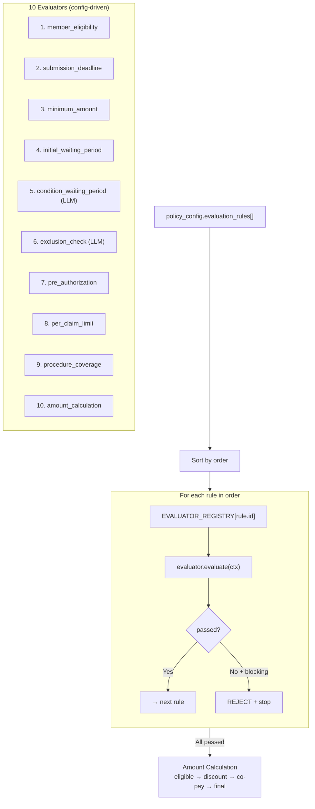

# Lambda Worker Pipeline — Internal Processing

## Diagram (Mermaid)

```mermaid
flowchart TD
    SQS[/"SQS Message<br/>{claim_id}"/] --> HANDLER

    subgraph HANDLER["Lambda Handler"]
        PARSE[Parse claim_id from SQS record]
        IDEMP{Idempotency Check<br/>sqs_message_id IS NULL?}
        LOAD[Load Context from DB<br/>• Claim record<br/>• Member record<br/>• Policy config<br/>• Claim documents<br/>• Claim history<br/>• YTD approved total]
        S3DL[Download images from S3<br/>for each document]
        STATE[Build ClaimState<br/>• All loaded data<br/>• Empty agent output slots<br/>• eval_date_override if eval]
    end

    PARSE --> IDEMP
    IDEMP -->|Already processed| SKIP[Skip — return OK]
    IDEMP -->|First time| LOAD
    LOAD --> S3DL --> STATE

    STATE --> PIPELINE

    subgraph PIPELINE["LangGraph Pipeline"]
        direction TB

        DOC_VERIFY["🔍 Document Verification<br/>(CRITICAL — Claude Vision)<br/>• Classify each document type<br/>• Quality score 0.0-1.0<br/>• Patient name extraction<br/>• Cross-document consistency"]

        DOC_VERIFY --> EARLY_CHECK{should_stop_early?}

        EARLY_CHECK -->|"Wrong docs / Unreadable / Mismatch"| EARLY_STOP["❌ Persist Early Stop<br/>status=COMPLETED<br/>decision=REJECTED<br/>error_message=specific guidance"]

        EARLY_CHECK -->|"All docs valid"| DOC_EXTRACT

        DOC_EXTRACT["📄 Document Extraction<br/>(DEGRADABLE — Gemini Vision)<br/>• Prescription: doctor, Dx, medicines<br/>• Bill: line items, amounts, total<br/>• Lab: test results<br/>• Per-field confidence scores"]

        DOC_EXTRACT --> POLICY_ENGINE

        POLICY_ENGINE["⚖️ Policy Engine Orchestrator<br/>(DEGRADABLE — Config-Driven)<br/>• Reads evaluation_rules from config<br/>• 10 evaluators executed in order<br/>• Short-circuits on blocking failure<br/>• Calculates: discount → co-pay → final"]

        POLICY_ENGINE --> FRAUD

        FRAUD["🚨 Fraud Detection<br/>(DEGRADABLE — Deterministic)<br/>• 8 signals from policy thresholds<br/>• Score = Σ(severity × weight) / 2.5<br/>• ≥0.50 → MANUAL_REVIEW"]

        FRAUD --> DECISION

        DECISION["✅ Final Decision<br/>(DEGRADABLE — Gemini)<br/>• Priority: fraud > reject > partial > approve<br/>• Confidence = 0.95 - deductions<br/>• Generate user message + ops summary"]

        DECISION --> PERSIST["💾 Persist Result<br/>• Write decision to claims table<br/>• Write trace_json<br/>• Update claim_documents with Vision results"]
    end

    EARLY_STOP --> DB_WRITE[(Neon PostgreSQL)]
    PERSIST --> DB_WRITE

    DB_WRITE --> SSE[/"SSE polls DB → UI updates"/]

    subgraph DEGRADATION["Error Handling"]
        direction LR
        CRITICAL_FAIL["CRITICAL step fails<br/>→ raise → SQS retries (3x)<br/>→ DLQ after exhaustion"]
        DEGRADE_FAIL["DEGRADABLE step fails<br/>→ catch exception<br/>→ confidence -= 0.15<br/>→ continue with defaults<br/>→ force MANUAL_REVIEW if <0.60"]
    end

    style DOC_VERIFY fill:#e8f5e9
    style DOC_EXTRACT fill:#e3f2fd
    style POLICY_ENGINE fill:#fff3e0
    style FRAUD fill:#fce4ec
    style DECISION fill:#f3e5f5
    style EARLY_STOP fill:#ffebee
    style PERSIST fill:#e8eaf6
```



## Policy Engine Detail (inside step ⚖️)



## Amount Calculation Waterfall

```
Original Amount (claimed)
    │
    ▼ Network discount (if network hospital)
    │  e.g., ₹4,500 × (1 - 20%) = ₹3,600
    │
    ▼ Co-pay (applied AFTER discount)
    │  e.g., ₹3,600 × (1 - 10%) = ₹3,240
    │
    ▼ Annual OPD limit check
    │  min(amount, remaining_annual_limit)
    │
    ▼ Floor at ₹0
    │
    = Final Approved Amount
```
